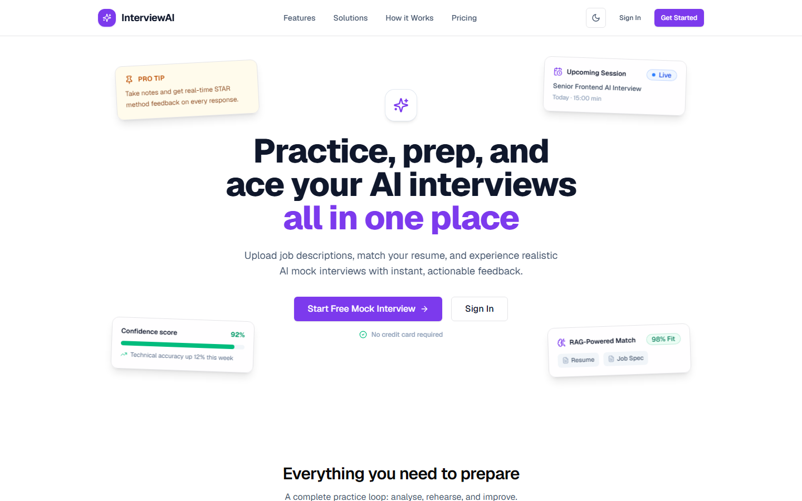
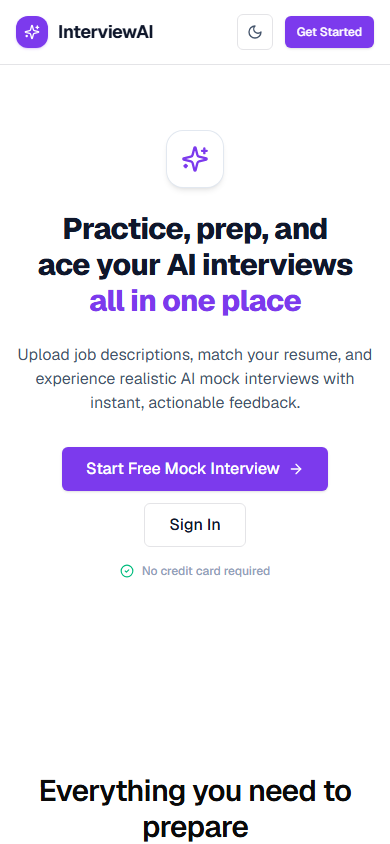
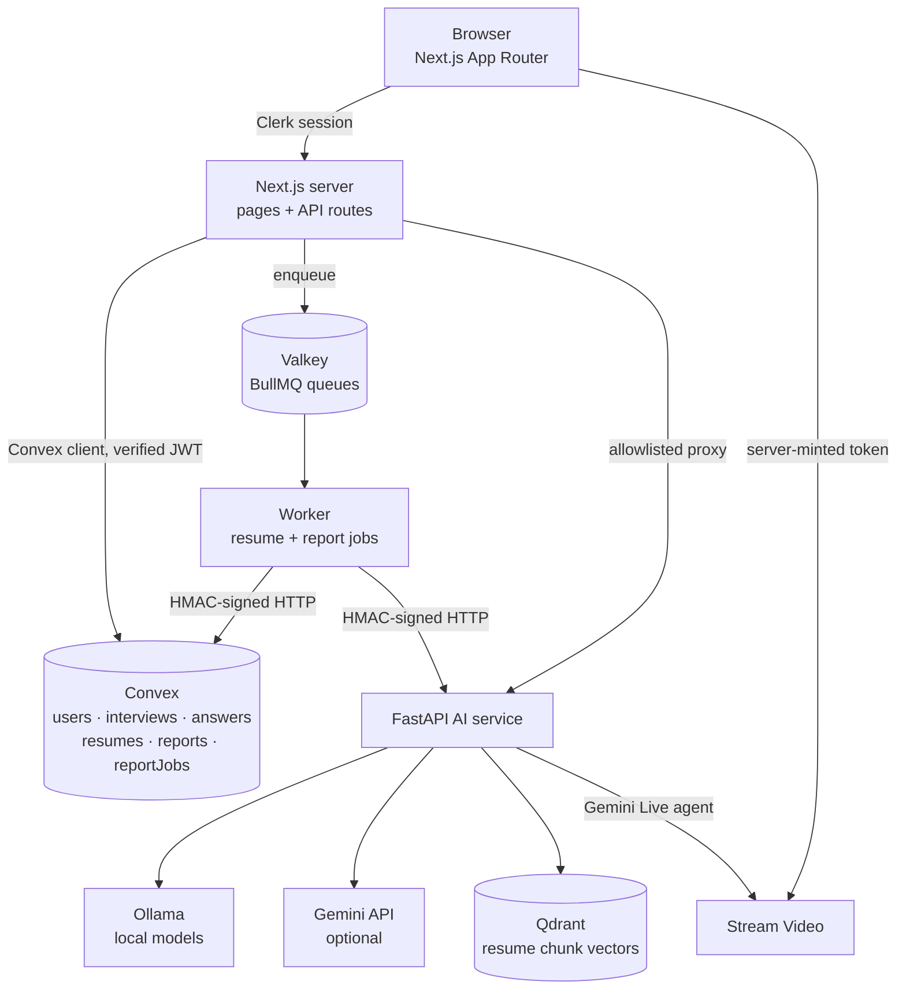

<div align="center">

<h1>Interview AI</h1>

<p><b>An AI interviewer that runs a live voice interview and then scores it against a weighted rubric — quoting the transcript for every point it awards.</b></p>

<p>
  <a href="#what-to-look-at-first-30-seconds"><b>What to look at first</b></a> ·
  <a href="#architecture"><b>Architecture</b></a> ·
  <a href="#running-locally"><b>Run locally</b></a> ·
  <a href="#tests-and-ci"><b>Tests</b></a> ·
  <a href="#known-limitations"><b>Limitations</b></a>
</p>

<p>
  
  
  
  
  
  
</p>

<picture>
  <source media="(prefers-color-scheme: dark)" srcset="docs/screenshots/landing-desktop-dark.png">
  <source media="(prefers-color-scheme: light)" srcset="docs/screenshots/landing-desktop.png">
  
</picture>

<sub>Landing page at 1440 × 900, captured from the running app with Playwright. Authenticated screens need a Clerk session and are not included yet.</sub>

<details>
<summary>Also captured at 390 px</summary>

<br>



</details>

</div>

> [!NOTE]
> **Status: portfolio project / MVP.** It runs locally end to end. It is not deployed, and it has no billing integration. The live room needs Stream and Gemini credentials; resume processing and reports run on local Ollama by default.

## What to look at first (30 seconds)

If you are reviewing this as a portfolio piece, these are the parts worth your time:

1. **The live room** — [`client/src/features/interview/room/`](client/src/features/interview/room/). Stream Video call, Gemini Live agent, caption capture, transcript deduplication, and answer persistence that survives a page reload.
2. **The service auth scheme** — [`convex/_lib/workerAuth.ts`](convex/_lib/workerAuth.ts), [`worker/src/http.ts`](worker/src/http.ts), [`apps/ai-service/app/api/deps.py`](apps/ai-service/app/api/deps.py). One HMAC canonical string implemented in TypeScript, Node, and Python, with shared test vectors so the three sides cannot drift.
3. **Scoring that the model cannot fake** — [`apps/ai-service/app/core/rubric.py`](apps/ai-service/app/core/rubric.py) and [`apps/ai-service/app/services/report_evaluation.py`](apps/ai-service/app/services/report_evaluation.py). Weights live in code; the model only supplies per-criterion sub-scores, and the worker re-verifies the result before it is stored.
4. **The architecture doc** — [`docs/architecture.md`](docs/architecture.md). Every component, table, route, trust boundary, and known failure mode, kept honest against the tree.

## What it does

1. A candidate signs in with Clerk.
2. Uploads a PDF resume (max 5 MB) and pastes a target job description.
3. A background worker extracts the resume text, chunks it, embeds it, and indexes it in Qdrant.
4. The AI service drafts a 5–7 question plan from the resume and the role.
5. The candidate joins a video call. A Gemini Live agent plays the interviewer and asks follow-ups by voice.
6. Closed captions become a transcript. Question/answer pairs are persisted as the call runs, so a reload continues where the candidate left off.
7. On finish, a queued job sends the transcript, resume, and job description to the AI service, which scores every evaluable question against a weighted rubric.
8. The report shows the overall score, per-question scores, evidence quotes, skill breakdown, strengths, weaknesses, and a development plan. It can be regenerated without losing the previous version.

## Features that work today

**Accounts and access**
- Clerk sign-in/sign-up; every query and mutation resolves the caller's identity from the verified token.
- Protected app routes redirect signed-out visitors; public pages (landing, sign-in, sign-up) stay readable.

**Resume pipeline**
- PDF upload to private Convex storage with a PDF extension/MIME check and a 5 MB cap.
- BullMQ job queue (Valkey) for extraction, chunking, embedding (Ollama `nomic-embed-text`), and Qdrant indexing.
- Resume status is observable: `uploaded → processing → ready` or `failed`.

**Interview session**
- AI-tailored question plan generated from the resume and job description.
- Stream Video room with a server-minted participant token; the Stream secret never reaches the browser.
- Gemini Live speech-to-speech interviewer with a bounded prompt (role, numbered plan, resume excerpt, untrusted-data note).
- Caption-based transcript with deduplication, persisted segments, and a visible warning when persistence degrades.
- Session timer that ends the interview and triggers the report.

**Report**
- Weighted rubric: technical correctness (30), relevance (20), conceptual understanding (15), completeness (15), problem-solving (10), communication (10).
- Scores are computed in code from per-criterion sub-scores; evidence quotes must appear verbatim in the transcript.
- Unanswerable questions are marked *not scored* rather than scored as zero.
- Versioned regeneration, job state polling, retry and failure states.

**Reports dashboard**
- Real Convex data: session count, average and best score, trend chart, date-range filter, CSV export.

**Interface**
- Light and dark themes, responsive layouts, visible focus rings, and explicit empty states.

## Architecture



| Component | Path | Runtime | Responsibility |
| --- | --- | --- | --- |
| Web app | `client/` | Next.js 16, React 19, Tailwind v4 | UI, routing, Clerk session, API proxies, Stream tokens |
| Data and auth | `convex/` | Convex | Users, interviews, answers, resumes, reports, job state, ownership checks |
| Worker | `worker/` | Node + BullMQ | Resume processing and report evaluation jobs, retries, terminal failures |
| AI service | `apps/ai-service/` | Python 3.12, FastAPI, uv | Extraction, embeddings, Qdrant retrieval, question plans, scoring, realtime agent |
| Vector store | `compose.yaml` | Qdrant 1.19 | Resume chunk vectors |
| Queue backend | `compose.yaml` | Valkey 8 | BullMQ persistence |

## How an interview runs

```
/sign-in
   └─► /dashboard
         └─► /interview/setup          upload resume + job description + duration
               └─► /interview/:id/lobby   wait for resume processing and plan
                     └─► /interview/:id       live room (Stream + Gemini Live)
                           └─► /interview/:id/report    scored report
                                 └─► /interview/:id/review    transcript review
```

The report page starts generation itself once answers or transcript segments exist, then polls `reportJobs`. A failed job waits for an explicit retry instead of looping.

## AI and real-time behaviour

**Question planning.** The AI service receives the extracted resume text and the job description and returns a structured plan. The plan is stored on the interview and reused for the live session and the report prompt.

**Live interviewer.** `/api/stream/agent` verifies the Clerk session and interview ownership, then asks the AI service to join `interview-{id}` as a vision agent. Instructions are built once at join: persona, job description, numbered questions, a capped resume excerpt, and an explicit note that candidate content is data, not instructions. The agent is asked to leave when the candidate ends the interview.

**Transcript.** Captions are captured from Stream events. Segments are deduplicated and stored; question/answer pairs are upserted by `(interviewId, questionIndex)`. Writes retry twice, and the UI shows a degraded-persistence warning rather than silently dropping turns.

**Evaluation.** The worker fetches a signed context payload from Convex, sends it to the AI service, and receives a report. The result is rejected unless quotes appear verbatim in the transcript, criterion scores respect rubric weights, skill scores are criterion means, and completion status matches scored coverage. The worker is the last validation boundary.

## Security and reliability

These are implemented in the repository, not aspirational:

- **Identity comes from the token.** Convex resolves `identity.subject → users.clerkId`. No function accepts a `clerkId` or `userId` from the request body as proof of ownership.
- **Ownership on every read.** Interviews, answers, resumes, and reports are filtered by the caller's user document.
- **Signed service calls.** Worker → Convex and worker → AI service use `X-Service-Timestamp` and `X-Service-Signature` over `timestamp\nMETHOD\npath?query\nsha256(body)`, with a 5-minute clock tolerance and timing-safe comparison. The same canonical string is implemented in TypeScript, Node, and Python. The browser never sees the shared keys; the Next.js proxy adds them server-side.
- **Fail-closed configuration.** The worker refuses to start without `AI_SERVICE_API_KEY`, `WORKER_SERVICE_KEY`, and `CONVEX_SITE_URL`, and re-checks at job time. Missing Convex worker configuration returns an error instead of silently dropping a result.
- **Quotas and rate limits.** Per-user fixed windows in Convex cover interview creation, resume processing, report generation, and Stream room joins. A denied request returns `429` with `Retry-After`; an unavailable limiter fails closed with `503`.
- **Upload limits.** PDF only (extension or MIME type), 5 MB maximum.
- **Private media.** Resumes live in Convex storage and are served through short-lived URLs. Stream tokens are minted server-side.
- **Bounded retries.** BullMQ retries jobs; terminal failures are recorded on the job document so the UI can show them.
- **Stale jobs are not successes.** Convex refuses a completion that would overwrite a newer report version.

## Tech stack

| Layer | Choice |
| --- | --- |
| Frontend | Next.js 16 (App Router), React 19, TypeScript strict, Tailwind v4 |
| UI | Radix primitives, `class-variance-authority`, `lucide-react`, `next-themes`, `sonner` |
| Auth | Clerk (JWT verified by Convex) |
| Data | Convex (queries, mutations, HTTP actions, storage) |
| Jobs | BullMQ over Valkey (Redis-compatible) |
| AI service | FastAPI, Pydantic, LangChain, uv |
| Models | Ollama (`llama3.2`, `nomic-embed-text`) by default; Gemini optional; Gemini Live for the realtime agent |
| Realtime | Stream Video SDK + closed captions |
| Vectors | Qdrant |
| Tests | Vitest + Testing Library, Bun test, pytest, Playwright |

## Repository layout

```
interview-ai/
├── client/                 Next.js app, API routes, Playwright specs
├── convex/                 Schema, queries, mutations, worker HTTP actions
├── worker/                 BullMQ consumers for resume + report jobs
├── apps/ai-service/        FastAPI service, rubric, realtime agent
├── docs/                   Architecture, deployment checklist, screenshots
├── compose.yaml            Qdrant, Valkey, AI service, worker
└── .github/workflows/ci.yml
```

## Running locally

### Prerequisites

- Bun 1.4+
- Docker (for Qdrant and Valkey)
- Python 3.12 and [uv](https://docs.astral.sh/uv/)
- [Ollama](https://ollama.com/) with `llama3.2:1b` and `nomic-embed-text`
- A Clerk application and a Convex project
- Optional: Stream and Gemini credentials for the live interviewer

### 1. Start infrastructure

```bash
docker compose up -d qdrant valkey
```

### 2. Start Convex

```bash
npx convex dev
```

Set the Convex-side environment values it needs:

```bash
npx convex env set CLERK_JWT_ISSUER_DOMAIN https://<your-instance>.clerk.accounts.dev
npx convex env set WORKER_SERVICE_KEY <shared-secret>
```

### 3. AI service

```bash
cd apps/ai-service
cp .env.example .env
uv sync --extra dev --extra realtime
uv run uvicorn app.main:app --port 8000
```

`--extra realtime` is required for the live interviewer. Remove it if you only want resume processing and reports.

### 4. Worker

```bash
cd worker
bun install
cp .env.example .env
set -a; . ./.env; set +a     # export the variables for the Node process
bun run build
bun run start
```

### 5. Web app

```bash
cd client
bun install
cp .env.example .env.local
bun run dev
```

Open `http://localhost:3000`.

> [!TIP]
> Use `localhost`, not `127.0.0.1`: Clerk only allows origins configured on the instance.

<details>
<summary><b>Environment variables (names only)</b></summary>

<br>

Never commit values, and never give a server key a `NEXT_PUBLIC_` prefix.

**Client (`client/.env.local`)**

| Variable | Purpose |
| --- | --- |
| `NEXT_PUBLIC_CONVEX_URL` | Convex deployment URL |
| `NEXT_PUBLIC_CLERK_PUBLISHABLE_KEY` | Clerk browser key |
| `CLERK_SECRET_KEY` | Clerk server key |
| `CLERK_JWT_ISSUER_DOMAIN` | Issuer Convex verifies tokens against |
| `AI_SERVICE_API_KEY` | Shared secret for the AI proxy; must match the AI service's `SERVICE_API_KEY` |
| `STREAM_API_KEY`, `STREAM_API_SECRET` | Stream Video server credentials |
| `REDIS_URL` | BullMQ producer connection |
| `CONVEX_SITE_URL` | Convex HTTP-actions host, when it cannot be derived |
| `RESUME_FETCH_HOST` | Rewrites the storage host when the AI service runs in Docker |
| `NEXT_PUBLIC_SENTRY_DSN` | Reserved for error monitoring; no SDK is initialised today |

**AI service (`apps/ai-service/.env`)**

| Variable | Purpose |
| --- | --- |
| `SERVICE_API_KEY` | Required; matches `AI_SERVICE_API_KEY` elsewhere |
| `AI_PROVIDER`, `AI_FALLBACK_PROVIDER` | `ollama` or `gemini` |
| `OLLAMA_BASE_URL`, `OLLAMA_MODEL` | Local model endpoint and name |
| `GEMINI_API_KEY`, `GEMINI_MODEL` | Optional remote provider |
| `QDRANT_URL`, `QDRANT_COLLECTION` | Vector store |
| `EMBEDDING_PROVIDER`, `EMBEDDING_MODEL`, `EMBEDDING_DIMENSION`, `EMBEDDING_CONFIG_VERSION` | Embedding configuration; changing any of these requires re-indexing |
| `STREAM_API_KEY`, `STREAM_API_SECRET` | Lets the agent join the call |
| `REALTIME_MODEL` | Gemini Live model used for speech-to-speech |

**Worker (`worker/.env`)**

| Variable | Purpose |
| --- | --- |
| `REDIS_URL` | Queue connection |
| `AI_SERVICE_URL`, `AI_SERVICE_API_KEY` | AI service endpoint and shared secret |
| `CONVEX_SITE_URL`, `WORKER_SERVICE_KEY` | Signed persistence back into Convex |
| `REPORT_AI_REQUEST_TIMEOUT_MS` | Upper bound for a local evaluation call |
| `WORKER_CONCURRENCY`, `REPORT_WORKER_CONCURRENCY` | Queue concurrency |

</details>

## Tests and CI

Measured on this tree on 2026-11-01:

| Area | Command | Result |
| --- | --- | --- |
| Client unit | `cd client && bun run test` | 306 passed in 29 files |
| Client types | `cd client && bunx tsc --noEmit` | clean |
| Convex types | `cd client && bunx tsc -p ../convex/tsconfig.json --noEmit` | clean |
| Worker | `cd worker && bun test` | 48 passed |
| Worker types | `cd worker && bun run typecheck` | clean |
| AI service | `cd apps/ai-service && uv run pytest -q` | 149 passed, 1 skipped |
| Room timing E2E | `cd client && bun run test:e2e:harness` | 1 passed |

Lint is only partially gated. `bun run lint` reports 0 errors and 9 warnings; Python lint (`ruff`) still has pre-existing findings and is not part of CI.

[`.github/workflows/ci.yml`](.github/workflows/ci.yml) runs the client tests, both typechecks, the production build, the E2E harness, the worker suite, and the AI suite. CI status is not claimed here — check the Actions tab of the repository you are reading.

## Known limitations

- **No billing.** The pricing section is UI copy. No payment provider is integrated and plan limits are not enforced.
- **Aspirational landing copy.** "100+ integrations", "time tracking", and "smart reminders" are not implemented. The floating hero cards (confidence score, fit percentage) are static illustrations, not live data.
- **Placeholder dashboard pieces.** The notes widget starts with template content, and "time saved" is a derived estimate. The History and Settings navigation entries do not have routes yet.
- **Live interview needs credentials.** Stream and a Gemini Live key are required; without them the room cannot connect.
- **Reports need a model.** Local Ollama on CPU can take minutes per report. Gemini is faster but optional and paid.
- **Upload validation is by type and size,** not by PDF magic bytes.
- **Error monitoring is off.** Sentry is installed but not initialised.
- **One resume per account.** Uploading a new resume replaces the previous one.
- **No deployment.** There is no hosted demo or demo account.
- **Screenshots cover public pages only** and must be re-captured after the planned UI redesign.

## Roadmap

1. Remove the placeholder dashboard widgets and dead navigation links.
2. Either integrate billing or remove the pricing section.
3. Add Settings and History, or drop them from the sidebar.
4. Add an authenticated Playwright journey (sign in → interview → report).
5. Deploy with a hosted model provider and document the cost per interview.
6. Support multiple resumes and shareable report links.

## Documentation

- [Architecture](docs/architecture.md) — components, data model, trust boundaries, failure modes.
- [Deployment checklist](docs/deployment-checklist.md) — configuration invariants and smoke tests.
- [Design system](docs/design-system.md) — tokens and component rules.
- [Status](docs/status.md) — evidence index for open gaps.
