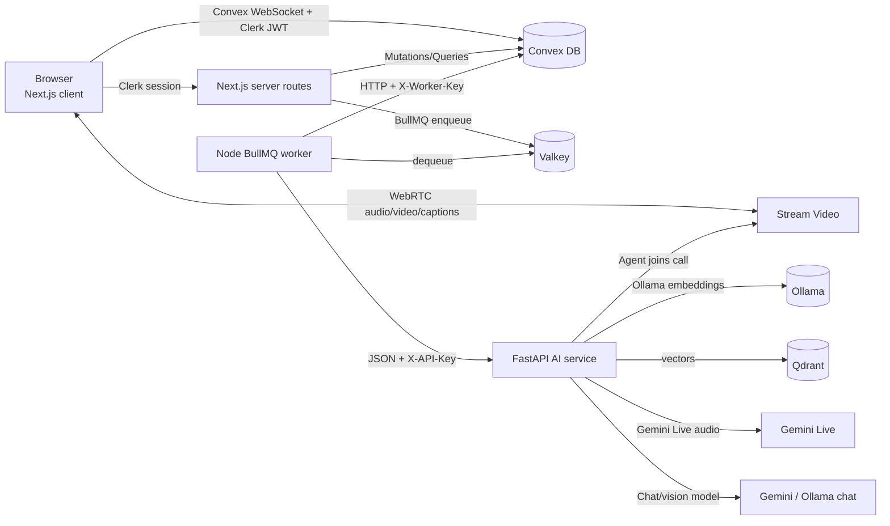
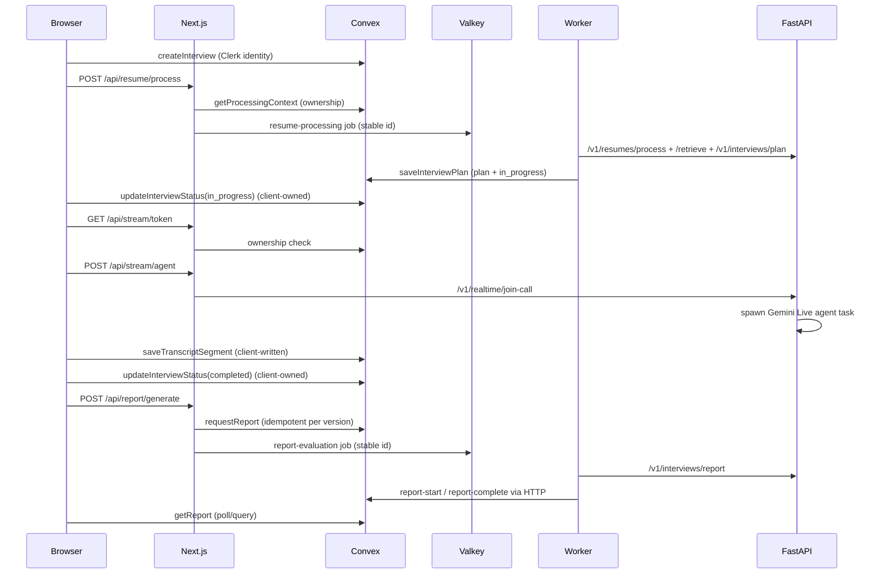
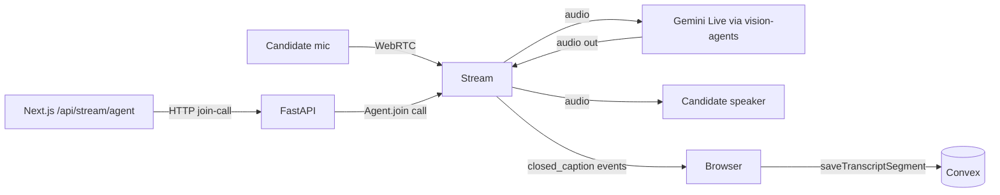
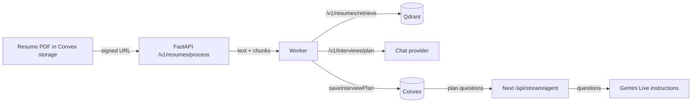
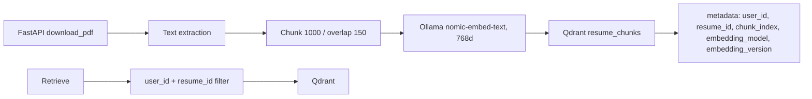
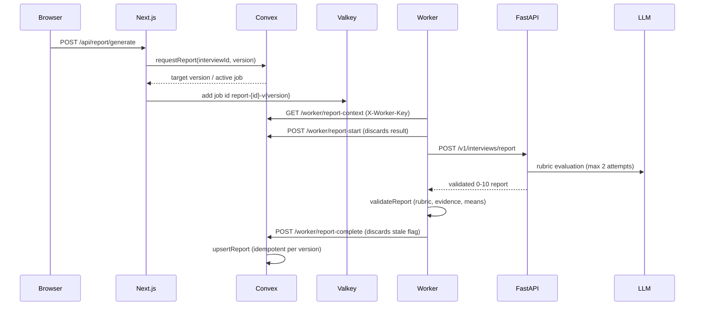

# Architecture and Risk Audit — Interview AI

**Phase:** 1a
**Date:** 2026-10-31
**Author:** coding agent, per `AGENTS.md` (215-line phase-plan version)
**Scope rule:** read-only audit. No application code, schema, config, dependency, or env file was changed. Only this file was created.

---

## 0. Method, evidence rules, and limitations

- Every finding below cites a real path and line number that was inspected in this repository.
- Gate results were produced by commands run in this session; commands and outcomes are recorded in §9.
- The debt register referenced by `AGENTS.md:60` and `AGENTS.md:166` **is not present** in the current `AGENTS.md` (the file contains phases and rules, not a G-xx table). Because inventing IDs would violate the Operating Contract, every finding is marked **NEW**.
- No authenticated browser session was available (Clerk-protected routes redirect to sign-in). Therefore this audit contains **no visual verification** and no screenshots. UI conclusions are derived from source code only. This limitation is repeated in `ui-ux-audit.md`.
- No web research was needed for 1a; the system is fully inspectable locally.

---

## 1. Repo map (verified paths)

| Path | Role |
|---|---|
| `client/` | Next.js 16 / React 19 / Tailwind app (Clerk auth, Stream video SDK, Convex client, BullMQ producer) |
| `client/src/app/(auth)/sign-in`, `sign-up` | Clerk auth surfaces |
| `client/src/app/dashboard` | Dashboard shell, stats, task table, schedule, notes |
| `client/src/app/interview/setup` | Create interview, upload resume, JD, duration |
| `client/src/app/interview/[id]/lobby` | Pre-call device check / readiness |
| `client/src/app/interview/[id]` | Live interview room host |
| `client/src/app/interview/[id]/report` | Report generation and display (rubric, evidence, retries) |
| `client/src/app/interview/[id]/review` | Q&A + narrative feedback review |
| `client/src/app/reports` | Cross-interview analytics, date range, CSV |
| `client/src/app/api/ai/[...path]` | Clerk-authenticated proxy to the legacy FastAPI AI endpoints |
| `client/src/app/api/report/generate` | Server route: Convex `requestReport` + BullMQ enqueue |
| `client/src/app/api/resume/process` | Server route: ownership check + BullMQ enqueue |
| `client/src/app/api/stream/token`, `api/stream/agent` | Stream token minting and AI-interviewer dispatch |
| `client/src/app/api/stripe`, `client/src/app/admin/billing` | **Empty directories** (billing scaffolding only) |
| `client/src/features/**` | Feature UI (interview room, lobby, dashboard widgets, landing) |
| `client/src/components/ui/**`, `client/src/features/components/common/**` | shadcn/Radix-style primitives |
| `convex/` | Source of truth: schema, queries/mutations, HTTP worker endpoints, Clerk identity |
| `worker/` | **Node/TypeScript** BullMQ workers over Valkey (`resume-processing`, `report-evaluation`) |
| `apps/ai-service/` | FastAPI service: interview plan, next question, report evaluation, resume PDF/embedding, realtime agent |
| `apps/web/` | Legacy directory containing only `AGENTS.md` |
| `compose.yaml`, `Dockerfile` (root) | Local multi-service orchestration |
| `scripts/` | `bench-ai.mjs`, `measure-client.mjs` only; no verification script |
| `docs/` | Existing docs (not read for this audit, per instruction); `docs/audit/` is new |

**Stack verification against `AGENTS.md` §STACK:**

| Claim | Verified | Evidence |
|---|---|---|
| Next.js + Tailwind + shadcn/ui + Clerk | Yes | `client/package.json:16-27`; Radix/CVA deps `:36-50`; `client/src/components/ui/*`; `convex/auth.config.ts` |
| Convex source of truth | Yes | `convex/schema.ts`, `convex/*.ts` |
| BullMQ over Valkey; Node or Python? | **Node/TypeScript** | `worker/src/index.ts`, `worker/package.json`, `compose.yaml` |
| FastAPI AI service | Yes | `apps/ai-service/app/main.py` |
| Qdrant + Ollama embeddings | Yes | `apps/ai-service/app/repositories/vector_store.py:42-48`; `config.py:55-65` |
| Stream + Gemini Live interviewer | Yes | `apps/ai-service/app/realtime/runner.py:80-105`; `client/src/features/interview/room/*` |

No stack mismatch found, except the worker language ambiguity (answered: Node, not Python).

---

## 2. Current architecture and data flow

### 2.1 System context

### 2.2 Interview lifecycle

### 2.3 Realtime audio path

Stream owns transport, rooms, participant tokens, and caption events. Gemini Live (through `vision-agents`) owns the speech-to-speech interviewer and its spoken reasoning. The browser is the only writer of transcript segments today (§A-04).

### 2.4 Question generation / RAG

A second, **unused by current UI** path exists: `client/src/lib/ai-service.ts:96-111` can call plan / next-question / evaluate through `client/src/app/api/ai/[...path]/route.ts:23-26`; no page imports that library (grep found no importers).

### 2.5 Embedding / indexing

Point IDs are deterministic `uuid5(version:resume_id:chunk_index)` and re-index deletes prior vectors for that resume (`vector_store.py:51-57,109-145`). A delete helper exists (`vector_store.py:109-119`) but **no HTTP route or Convex path calls it** (grep found only the `.pyc`), so deleting a resume orphans vectors (§A-06).

### 2.6 Report pipeline

FastAPI is stateless per call and the Node worker orchestrates; this already matches the Phase 5 default design. The defect is at the Convex HTTP bridge (§A-02).

### 2.7 Credits and payments

**Absent.** `convex/schema.ts` defines `users, interviews, answers, transcriptSegments, resumes, reports, reportJobs` only (`:75-228`). There is no wallet, ledger, reservation, subscription, invoice, or tenant table. `client/src/app/api/stripe` and `client/src/app/admin/billing` are empty directories; `stripe` is not a dependency. `.env.example:39-50` documents Stripe variables and `/admin/billing` that do not exist in code.

---

## 3. Stream vs Gemini Live responsibilities

| Concern | Stream | Gemini Live (vision-agents) | Evidence |
|---|---|---|---|
| Call/room creation, participant auth | Yes | No | `client/src/app/api/stream/token/route.ts`; `runner.py:90` |
| Audio/video transport, WebRTC | Yes | Consumes/produces audio through Stream | `runner.py:80-105` |
| Speech-to-speech interviewer | No | Yes | `runner.py:6-9,80-88` |
| Question plan | No | Injected into instructions | `api/stream/agent/route.ts:93-95`; `instructions.py:38-69` |
| Closed captions / transcript source | Yes (`closed_caption` events) | Not the transcript source | `transcription-panel.tsx:34-45` |
| Transcript persistence | No | No | Browser writes to Convex (`use-transcript-recorder.ts`) |
| Reconnect/room state | Stream SDK (not surfaced) | Not surfaced | `interview-room.tsx:57-90` |

No duplicated capability was found: the interviewer's voice comes only from Gemini Live, and captions come only from Stream. The reliability gap is that neither side's connection state is surfaced to the user or persisted.

---

## 4. Cross-service call map and identity at each hop

| Hop | Credential | Identity asserted | Ownership enforced | Evidence |
|---|---|---|---|---|
| Browser → Next.js | Clerk session cookie | Clerk user | Middleware protects `/dashboard(.*)` and `/interview(.*)` only | `client/src/proxy.ts:3-5` |
| Browser → Convex | Clerk JWT (`applicationID: convex`) | `ctx.auth` user | Each function calls `requireAuthUserId` | `convex/auth.config.ts`; `convex/auth.ts` |
| Next.js → Convex | Convex client with Clerk token | End user | Functions re-derive user | `client/src/app/api/*` |
| Next.js → Valkey | Redis URL only | **None** | Job payload carries ids; worker re-reads context | `api/report/generate/route.ts:113-128`; `api/resume/process/route.ts:83-97` |
| Worker → Convex HTTP | `X-Worker-Key` shared secret | **Service-wide, no tenant** | Internal mutations trust payload ids | `convex/http.ts:10-15` |
| Worker → FastAPI | `X-API-Key` shared secret | **Service-wide, no tenant** | Request body carries `user_id`/`resume_id` | `apps/ai-service/app/api/deps.py:8-12` |
| Next.js → FastAPI (legacy proxy) | Clerk session + injected server key | End user at proxy; **not forwarded** | Allowlist only; no per-user authorization inside FastAPI | `api/ai/[...path]/route.ts:23-26,59` |
| AI service → Stream | Stream API key/secret | Agent user id from config | Call id supplied by Next | `runner.py:75-90`; `config.py:76-79` |
| Browser → Qdrant | **No path** (server-only) | n/a | n/a | `vector_store.py` |
| AI service → Qdrant | Optional `qdrant_api_key` (default empty) | none | `user_id + resume_id` metadata filter | `config.py:63-65`; `vector_store.py:60-70` |

**Conclusion:** user identity is strong at the browser↔Next↔Convex boundary. It collapses to a shared secret for worker↔Convex, worker↔FastAPI, and Next↔FastAPI. That is acceptable only inside a private network with rotation and fail-closed configuration; neither is guaranteed today (§A-01, §A-07).

---

## 5. Findings

Severity: **Critical** = exploitable now with material cost/data impact; **High** = integrity, authorization, or documented-contract risk; **Medium** = reliability/scale/maintainability; **Low** = consistency/hygiene.
Effort: **S** ≈ under a day, **M** ≈ 1–3 days, **L** ≈ 3+ days (relative, single engineer).

| ID | Sev | Finding | Evidence (file:line) | Impact | Fix | Effort | G-xx |
|---|---|---|---|---|---|---|---|
| A-01 | Critical | Default service secret plus published AI port plus a PDF fetcher that follows arbitrary URLs | `compose.yaml:53,72,84`; `config.py:47`; `deps.py:11-12`; `api/v1/resumes.py:24-30` | Any host process (or anyone with the default key) can call paid LLM/embedding endpoints and make the service fetch arbitrary internal URLs (SSRF) | Require non-default key at startup; constant-time compare; stop publishing `8000`; allowlist download host/scheme; disable redirects; block private IP ranges | M | NEW |
| A-02 | High | Stale-report contract is discarded at the Convex HTTP bridge | `convex/http.ts:167-177,229-255`; `worker/src/report-processor.ts:325,526`; `convex/worker.ts:173-183,233-237` | A superseded job still runs the full paid evaluation, is reported as success instead of unrecoverable, and leaves ops/UI state ambiguous | Return the mutation result (`return jsonResponse(result)`) for `report-start` and `report-complete`; add an integration test for the stale path | S | NEW |
| A-03 | High | Client owns interview lifecycle and plan | `convex/interviews.ts:58-106`; `lobby/page.tsx:84`; `interview/[id]/page.tsx:52,61` | Any owner can force `completed`/`in_progress`, overwrite plan and question index; report gating and analytics are untrustworthy | Explicit state machine in internal mutations; client sends intents only; typed plan validator | M | NEW |
| A-04 | High | Evidence layer is client-authored | `convex/answers.ts:15-53,77-146`; `use-transcript-recorder.ts:29-80`; `schema.ts:119-121` | A candidate can fabricate the transcript/answers a hiring report is built from; no provider-attested audit trail | Ingest captions server-side (Stream webhook or signed relay), bind to call/participant, mark source and immutability | L | NEW |
| A-05 | High | No rate limits or spend caps on paid paths | grep found no limiter in `client/src`, `convex`, `worker/src`, `apps/ai-service/app`; `api/ai/[...path]/route.ts:23-26`; paid calls at `report-processor.ts:294-316`, `processor.ts:137-180` | One account can exhaust provider quota/cost; no concurrency control; trivial abuse | Per-user/per-org token bucket at Next and FastAPI; concurrency caps; daily spend budget; payload limits | M | NEW |
| A-06 | High | Resume upload trusts declarations and deletion orphans vectors | `convex/resume.ts:18-33`; `markResumeStatus` `:102-123`; `deleteResume` `:125-135`; unused `vector_store.py:109-119` | Non-PDF or oversized files enter the pipeline; client can spoof `ready`; deleted resumes keep embeddings (retention/privacy violation) | Verify magic bytes and size server-side; make `markResumeStatus` internal; add an authenticated vector-delete call on delete; retention job | M | NEW |
| A-07 | High | Static shared secrets with unsafe comparison | `convex/http.ts:10-15`; `apps/ai-service/app/api/deps.py:8-12`; `compose.yaml:53,84` | No rotation/scope/expiry; Python compare is not constant-time and accepts empty-vs-empty; one leak grants worker-level writes | HMAC-signed short-lived requests (timestamp + nonce), `compare_digest`, separate secrets per hop, rotation and secret scanning | M | NEW |
| A-08 | High | No tenancy, roles, or org isolation | `convex/schema.ts:75-86` and all tables; ownership is per `userId` only | Cannot support the B2B team/pipeline model in `AGENTS.md`; retrofitting tenancy later touches every function and vector payload | Additive `organizations` + `memberships`, `orgId` on tenant rows, server-derived org, personal-org backfill | L | NEW |
| A-09 | Medium | No credits/payments; pricing UI makes unenforced promises | `schema.ts:201-228`; empty `client/src/app/api/stripe`, `client/src/app/admin/billing`; `PricingSection.tsx:22-60`; `.env.example:39-50` | "3/month", "Unlimited", "RBAC" cannot be enforced; no cost control; dishonest capability | Phase 3 ledger + reservations; until then remove/mark the claims unavailable | L | NEW |
| A-10 | Medium | Interview plan is `v.any()` end to end | `schema.ts:99`; `interviews.ts:67,92`; worker writes at `processor.ts:179-212` | Malformed plan breaks realtime join and UI; no schema-evolution safety | Concrete plan validator (question objects, max lengths/count), validate before save, migrate legacy rows | S–M | NEW |
| A-11 | Medium | BullMQ enqueue happens in Next.js routes, conflicting with `AGENTS.md` rule 10 | `api/report/generate/route.ts:113-128`; `api/resume/process/route.ts:83-97`; `AGENTS.md:27-28` | Two trust boundaries and credential sets; documented architecture does not match code; enqueue outcome is not recorded in Convex | Move enqueue behind a Convex action (or get an explicit exception), keep stable idempotency keys | M | NEW |
| A-12 | Medium | Legacy AI proxy exposes endpoints the UI no longer uses | `api/ai/[...path]/route.ts:23-26`; `lib/ai-service.ts:96-111` (no importers) | Any signed-in user can reach paid plan/next-question/evaluate endpoints; dead code drift | Remove the proxy and client lib, or restrict to explicit admin/health use | S | NEW |
| A-13 | Medium | Vector metadata and lifecycle incomplete | `vector_store.py:130-145` (no `embedding_dimensions`, `content_hash`, `created_at`); `ensure_collection` per search `:87-106,155` | Silent space mixing on model change; no cache/re-index audit; avoidable latency per query | Phase 7 metadata + versioned collection + migration tool; cache collection readiness | M | NEW |
| A-14 | Medium | Realtime agent state is in-process only | `realtime/manager.py:17-70`; `runner.py:68-105` | Restart or a second replica loses/apart "already running" knowledge; no cross-instance coordination | Lease/heartbeat in Convex or Valkey, idempotent join, status endpoint; or document single-replica constraint | M | NEW |
| A-15 | Medium | Realtime reliability/state is not surfaced | `interview-room.tsx:57-90` (hardcoded "Live"); `stream-provider.tsx:162-175` (raw `error.message`) | Users cannot distinguish outage from interview state; internals leak; no recovery path | Surface Stream connection/reconnect state, map errors to recovery actions, remove raw messages | M | NEW |
| A-16 | Medium | Monitoring and correlation incomplete | `lib/glitchtip.ts` wraps Sentry but no `Sentry.init`/config files exist; `console.error` only in routes/worker; no request/job correlation id across hops | Production failures (stuck report, provider error) are not diagnosable end to end | Init client/server/edge Sentry; propagate correlation and job ids; structured logs | M | NEW |
| A-17 | Medium | No dead-letter, lease, or admin retry | retries at `report-processor.ts:325,526,540`; `processor.ts:234`; report UI re-enqueues queued jobs every 60 s `report/page.tsx:569-577` | Exhausted jobs need manual intervention; stuck `processing` rows have no operator path | DLQ, lease/heartbeat timestamps, admin retry, reconciliation job | M | NEW |
| A-18 | Medium | No security headers or CSP | `client/next.config.ts` has no `headers()` (grep: 0 hits) | Weaker XSS/clickjacking defense in depth | Add headers/CSP with Clerk, Stream, Convex origins after testing | M | NEW |
| A-19 | Low | Prompt delimiters are not escaped | `apps/ai-service/app/ai/prompts/report.py:40-45` inserts raw text inside XML-like tags; warning at `:12-13` | Candidate text containing closing tags can escape its data context | Escape/strip tag delimiters or serialize as JSON; add adversarial tests | S | NEW |
| A-20 | Low | Test/lint baseline is red; no backend tests | 6 failing client tests (`InterviewLobby.test.tsx:98,124,149`; `JobDescriptionInput.test.tsx:24,31,50`); ruff exits 2 on `QTY`; `convex/tests/` empty; 9 lint warnings | No trustworthy regression gate for Phases 2–10 | Fix stale tests; fix/remove invalid ruff selector; add Convex tests; add CI script | S–M | NEW |
| A-21 | Low | Dead/duplicate scaffolding | `apps/web/` (only AGENTS.md); empty `api/stripe`, `admin/billing`; duplicate `client/src/components/layout/Sidebar.tsx` and `features/components/layout/Sidebar.tsx`; no `scripts/verify*` | Confusion, dead routes, audit drift | Delete or implement deliberately; add a single verify script | S | NEW |
| A-22 | Low | Env/docs drift | `.env.example:5` says port 3000; `.env.example:39-50` Stripe vars; `apps/ai-service/.env.example:8,24` (`dev-secret-key-change-in-production`, `gemini-1.5-flash`) vs `config.py:18,47` (`gemini-3.8-flash`, `dev-secret-key`); `worker/.env.example:16` default key | Onboarding errors; accidental default secrets; model mismatch between docs and runtime | Generate/validate env examples from config; fail on defaults in production | S | NEW |
| A-23 | Low | Type safety bypassed at the worker HTTP boundary | `convex/http.ts:168,230,237,241-244` (`as never`) | Malformed payloads rely on runtime validators; compile-time protection lost where it matters most | Parse with Convex validators before calling internal mutations; remove casts | S | NEW |
| A-24 | Medium | Lobby readiness uses the newest resume, not the interview's resume | `lobby/page.tsx:33` (`getMyResume`), while interview stores `resumeId` (`schema.ts:90`) | With multiple resumes, the lobby checklist can describe a different file than the interview uses | Query the interview's resume by `interview.resumeId` and show its processing status | S | NEW |
| A-25 | Low | `Time Saved` is a fixed heuristic presented as a stat | `StatsOverview.tsx:12-13,52,63-65` | A fabricated-looking metric violates the no-fabricated-metrics rule | Compute from `startedAt`/`completedAt` or remove | S | NEW |

### Notes on the strongest findings

**A-01 — why Critical.** The AI service is published on the host (`compose.yaml:72`), its API key defaults to a known string in both compose and Python (`compose.yaml:53,84`; `config.py:47`), and `/v1/resumes/process` downloads a caller-supplied URL with redirects enabled (`resumes.py:24-30`). In a local or misconfigured deployment this is a direct path to provider spend and internal-network probing. The default is dev-only in intent, but nothing prevents it from reaching production.

**A-02 — precise behavior.** `completeReportJob` correctly refuses a superseded version (`worker.ts:233-237`), so DB integrity holds. However, `convex/http.ts:229-255` drops the returned `{ success, stale }`, and the worker's guard at `report-processor.ts:325,526` therefore never fires. The stale job burns a full model call and completes as success. Start/complete responses should pass the mutation result through; HTTP 200 with `{success:false, stale:true}` is the contract the worker already expects.

**A-04 — scope caveat.** Client-authored evidence is inherent to the current Stream-caption design and is acceptable for a practice product. It is not acceptable for a B2B hiring record, which `AGENTS.md` defines as the target. This finding is therefore a prerequisite for the Phase 5 evidence guarantees, not just a Phase 2 hardening item.

---

## 6. Must-not-break list

These are verified working behaviors to preserve through Phases 2–10:

1. **Clerk → Convex identity sync** and the email-taken redirect (`UserSyncProvider.tsx`; `convex/auth.ts`; `convex/users.ts`).
2. **Ownership checks** on every Convex query/mutation via `requireAuthUserId` (`convex/auth.ts`; `getProcessingContext` `resume.ts:75-98`; stream token/agent routes).
3. **Deterministic report scoring** and evidence validation: code computes weighted scores and means; the model only supplies criterion scores (`report_evaluation.py:1-6,160-339,343-388`).
4. **Verbatim-evidence rule** in both FastAPI and the Node worker (`report_evaluation.py`; `worker/src/report-processor.ts:173-262`).
5. **Versioned, idempotent reports**: regeneration creates a new version; readers take the newest; stale writes are refused (`convex/reports.ts:96-236`; `worker.ts:205-299`).
6. **Stable BullMQ job ids** per report version and per interview/resume pair (`api/report/generate/route.ts:113-128`; `api/resume/process/route.ts:83-97`).
7. **Resume pipeline**: PDF → chunks → Ollama embeddings → Qdrant, with `user_id + resume_id` filtering on every read (`vector_store.py:60-70,122-164`).
8. **Realtime join path**: token and agent dispatch both verify interview ownership before contacting Stream/FastAPI (`api/stream/token/route.ts`; `api/stream/agent/route.ts`).
9. **Transcript classification and evidence persistence**: server-side kind derivation, stable segment keys, upsert semantics (`convex/answers.ts:77-146`).
10. **Report UI states**: queued, processing, failed/retry, regenerate, insufficient-evidence, rubric cards, counts, warnings (`report/page.tsx`).
11. **Local Ollama development path** (no Gemini quota required) and provider fallback (`config.py:22-34`; `ai/providers`).
12. **Tests that currently pass**: 217 client tests, 115 pytest, 16 worker tests (see §9).

---

## 7. Proposed Phase 2–10 order and sub-phase split

Order is risk-first and respects dependencies. Each sub-phase targets ≤8 files; if a step grows beyond that, split again and stop.

### Phase 2 — Security, tenancy, secrets
- **2a — Trust boundaries and secrets (S–M):** fail-closed config, constant-time/HMAC internal auth, unpublish AI port, separate secrets, secret scan. Files: `deps.py`, `convex/http.ts`, `config.py`, `compose.yaml`, env examples, tests. (Addresses A-01, A-07.)
- **2b — Tenancy schema + core enforcement (M):** additive `organizations`/`memberships`, `orgId` on `users/interviews/resumes`, server-derived org, personal-org backfill. (A-08.)
- **2c — Tenancy for reports/answers/transcripts + tests (M):** remaining functions and cross-tenant denial tests. (A-08.)
- **2d — Uploads, retention, vector deletion (M):** magic-byte/size verification, internal resume status, authenticated vector delete, retention. (A-06, A-13 partial.)
- **2e — Abuse controls and surface reduction (M):** rate limits, CSP/headers, delete the unused AI proxy/lib. (A-05, A-12, A-18.)

> Phase 2 is intentionally split into five stops. Attempting tenancy and uploads in one run would exceed the 8-file budget and the reviewable-diff rule.

### Phase 3 — Credits and payments
- **3a:** ledger schema + pure Convex mutations + invariant tests (purchase/reserve/consume/release/refund/admin).
- **3b:** reservation/settlement wired into interview start and report generation; idempotency keys.
- **3c:** provider interface + webhook HTTP action (Stripe vs Razorpay decision recorded before coding).
- **3d:** usage/cost hooks for Phase 10; no UI yet.

### Phase 4 — Interview lifecycle and jobs
- **4a:** explicit state machine, server-owned transitions, typed plan validator. (A-03, A-10.)
- **4b:** server-side transcript ingestion + move enqueue behind a Convex action. (A-04, A-11.)
- **4c:** DLQ, lease/heartbeat, admin retry, reconciliation. (A-17.)
- **4d:** expiry/cancellation/audit history + lobby resume linkage. (A-24.)

### Phase 5 — Report pipeline
- **5a:** keep Node worker as orchestrator (verified), fix HTTP bridge result passthrough, typed payloads. (A-02, A-23.)
- **5b:** per-stage checkpoints in Convex, resume-from-crash tests, prompt delimiter hardening. (A-19.)
- **5c:** evidence timestamps/segment references in report schema + UI contract. (A-04 follow-through.)
- **5d:** PDF/notify only if a real delivery path is chosen (no stubs).

### Phase 6 — Provider abstraction
- **6a:** interfaces + capability registry + startup validation.
- **6b:** chat adapters (Ollama/Gemini/OpenRouter/Groq) with contract tests.
- **6c:** embedding adapters + dimension validation.
- **6d:** realtime voice adapter (Gemini Live only; no mid-session switching).

### Phase 7 — Embeddings, Qdrant, RAG
- **7a:** embedding service (batching, retries, cache, metadata incl. `embedding_dimensions`, `content_hash`, `created_at`). (A-13.)
- **7b:** versioned collections + migration/rollback tooling.
- **7c:** RAG flow + fixed eval set (quality/latency/cost), citations, tenant filter.

### Phase 8 — Realtime reliability
- **8a:** connection/reconnect state and user-safe error mapping. (A-15.)
- **8b:** agent session coordination/lease and duplicate-join protection. (A-14.)
- **8c:** metrics from a real run (speech-end→first-audio p50/p95, disconnect/reconnect, cost/minute).

### Phase 9 — Production SaaS interface (always sub-phased)
- **9a:** design tokens, shared components, app shell/navigation; remove dead links, fake search, sparkles, glows. (U-01…U-04.)
- **9b:** dashboard + candidate pipeline/detail — **blocked on Phase 2 tenancy and Phase 4 lifecycle**; if those are not done, ship dashboard-only and mark pipeline unavailable.
- **9c:** live room + transcript + report/evidence review (timestamps, mobile transcript, connection state). (U-06…U-12.)
- **9d:** credits/billing + settings/integrations/ops — depends on Phase 3 and Phase 10a.
- **9e (new):** landing/marketing truthfulness — pricing and claims either real or explicitly unavailable. (U-03.)

### Phase 10 — Observability, ops, docs
- **10a:** Sentry init, structured logs, correlation ids, metrics, admin/debug view. (A-16.)
- **10b:** docs/env/README/verify script; restore a real debt register and re-issue the verdict. (A-20…A-22.)

---

## 8. Working-feature inventory (what the repo already does well)

- Strict, deterministic report evaluation with retries and corrective prompting.
- Idempotent, versioned report writes and a rich report UI (states, rubric cards, evidence, warnings, regeneration).
- Ownership derived from Clerk identity on all user-facing Convex functions.
- Deterministic vector IDs, re-index replacement, and user/resume-scoped retrieval.
- Server-side realtime dispatch with ownership checks and prompt-injection framing for resume/JD.
- Local-first AI development path (Ollama) with optional Gemini.

---

## 9. Baseline gates actually run (this session)

| Gate | Command | Result |
|---|---|---|
| Client typecheck | `cd client && bunx tsc --noEmit` | **PASS** (exit 0) |
| Client lint | `cd client && bun run lint` | **PASS with warnings** — 0 errors, 9 warnings (unused imports) |
| Client tests | `cd client && bun run test` | **FAIL** — 223 tests, 217 pass, 6 fail (3 InterviewLobby, 3 JobDescriptionInput; stale copy/class expectations) |
| AI service tests | `cd apps/ai-service && uv run pytest -q` | **PASS** — 115 passed, 1 skipped |
| Worker typecheck | `cd worker && bunx tsc -p tsconfig.json --noEmit` | **PASS** (exit 0) |
| Worker tests | `cd worker && bun test` | **PASS** — 16 passed |
| Python lint | `cd apps/ai-service && uv run ruff check app` | **FAIL (exit 2)** — `Unknown rule selector \`QTY\`` in `pyproject.toml` |
| Secrets scan | `rg "dev-secret-key"` | Hits: `compose.yaml:53,84`; `apps/ai-service/app/core/config.py:47` (plus env examples) |
| Browser/visual | n/a | **NOT RUN** — no authenticated session; protected routes redirect |

Production build (`next build`) was **not** run in Phase 1; it is deferred to the first implementation phase so its result is not misreported.

---

## 10. Key risks in one paragraph

The product's core AI quality work is strong, but the deployment and trust story is not production-ready. A known default service key on an exposed AI port, a URL-fetching endpoint, and no rate limits create a realistic cost/SSRF path (A-01, A-05). The hiring record can be authored by the candidate (A-03, A-04), which undermines the B2B promise. The stale-report contract is broken at the HTTP bridge (A-02), and there is no tenancy, billing, retention, or end-to-end observability (A-08, A-09, A-06, A-16). Fixing these in the proposed order — secrets/boundaries first, then tenancy, then lifecycle/evidence, then reports — is the shortest path to a defensible production system.
